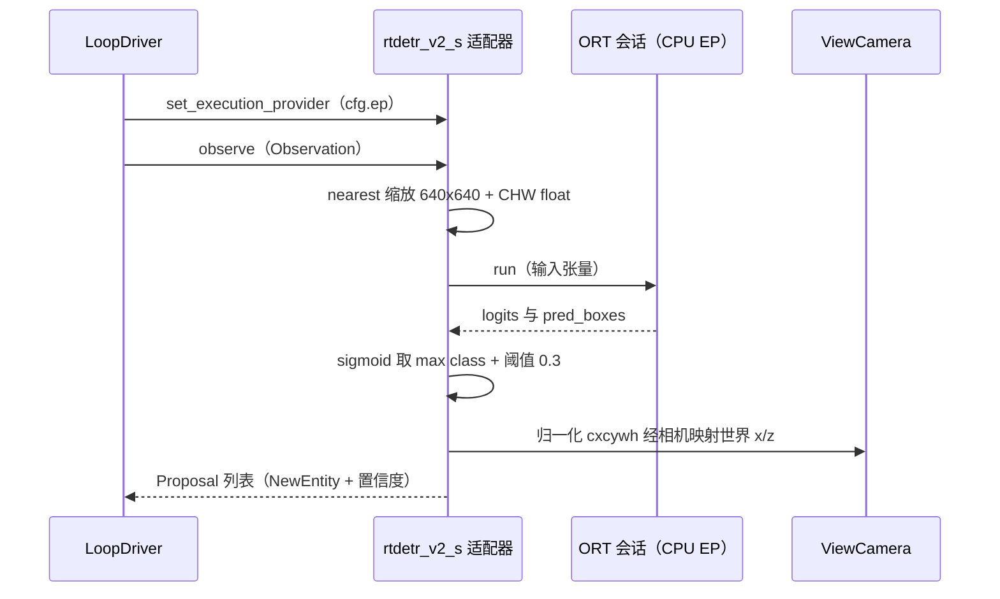

# L2 · 切片 C3「RT-DETRv2-S 适配器」详细设计

> **设计版本**：v1 · **批准方式**：预授权（owner「推送吧，然后继续开发」指令链延展，2026-10-16；授权范围 = 阶段 C 各切片；偏离即停并回报） · **批准日期**：2026-10-16
> 状态：**已实现并验证（2026-10-19 收口）**——票据置 done。实测与本文的偏差全部登记在文末「偏差与扩展记录」（预处理插值核、空帧 AC、first_fault、类别标签、构建层）；证据：[C3 regression 报告](../../../../benchmarks/regression/2026-10-19-stage-c-c3-rtdetrv2s.md)。
> 上承：[L1 §4 签名](../概要设计.md)（单文件适配器、双 provider、`--ep` 运行时选择）+ C1 research note（ORT 1.31 / cuDNN 缺口）+ C2（Observation 多分辨率）。票据：[03-rtdetrv2s-adapter.md](../../../../.scratch/stage-c-ai-in-loop/issues/03-rtdetrv2s-adapter.md)。

## 1. 程序描述

**真 AI 首次在环**：RT-DETRv2-S（ONNX，`models/rtdetrv2-s-onnx.onnx`，SHA256 已 pin）以单文件 Perception Adapter 接入同一契约——`observe(Observation) → Proposal[]`。预处理（resize/normalize）归适配器所有（阶段 A slice03 已定）；输出（300 框 × 80 类 logits + 归一化 cxcywh 框）映射为 Proposal 五元组。

## 2. 数据结构

- `ExecProvider` 从 driver.hpp **移入 core/types.hpp**（避免 perception → loop 反向依赖；同 BoundsPolicy 先例）。
- `PerceptionAdapter` 接口**增补默认虚函数** `set_execution_provider(ExecProvider)`（默认 no-op；核心在 make() 后按 RunConfig.ep 调用）——这是接口的第一次扩展，记录为**明示扩展**（非语义破坏：既有适配器零改动，默认行为不变）。
- 适配器内部：ORT 会话（`Ort::Session`）、输入名/输出名运行期探测、线程数 1（确定性）、图优化 ORT_ENABLE_ALL。
- 模型路径解析：env `OW_RTDETR_MODEL` > 编译定义 `OW_MODELS_DIR` + 文件名 > `models/rtdetrv2-s-onnx.onnx`。

## 3. 关键机制

- **预处理（适配器自有）**：Observation（W×H×3 RGB8）→ nearest 缩放到 640×640 → CHW float /255。nearest 选型理由：确定性、零插值代数、与观察语义一致。**（实测改为 bilinear + 不归一化，理由与一手依据见偏差记录 #4——设计期此处假设了参考处理器的行为，未核对。）**
- **后处理**：sigmoid(logits) 逐框取 max class → 阈值 0.3 → 框（归一化 cxcywh）→ 世界坐标（**观察相机覆盖 [0,1]²，故 cx/cy 直映 x/z**——ViewCamera 的契约红利）。
- **确定性**：CPU EP + 单线程 + 图优化固定 → 同输入逐位可复现（测试断言）；CUDA EP 路径接线但**本机阻塞**（无 cuDNN 9 / CUDA 12.8+，research note §1）——`--ep cuda` 在 ORT 缺席/EP 不可用时 fail-fast 报错而非静默降级。
- **adaptor 不变式**：单文件 + CMake 一行 + 编译守卫 `#if OW_WITH_ONNXRUNTIME`；核心零 include。
- **真实场景的诚实预期**：合成场景（8 个小色块）对自然图像训练的检测器可能**检出率为零或极低**——首次跑出什么就报什么；footprint 敏感性作为实验记录（不调场景迁就模型）。

## 4. 流程逻辑

## 5. 边界情形

| 情形 | 行为 |
|---|---|
| ORT 未启用构建 | 文件不参与编译（守卫）；适配器名不可见——注册表查无此人（fail-fast 语义由 call site 承担） |
| 模型文件缺失 | 适配器构造时抛错（含期望路径与 fetch 指引） |
| 检出为零 | 空 Proposal 列表（合法——如实反映模型能力）。**（实测：分布外帧上"零检出"并不发生，见偏差记录 #5）** |
| 输入分辨率小于模型输入 | nearest 上采样（保持确定性；不失真约束不适用于合成块场景） |
| 输出名约定漂移 | 运行期探测（按末维 4 / 类数量识别），不写死字符串 |

## 6. 测试计划（slice13，仅 ORT ON 构建注册；行为 + 确定性成对）

1. **会话与推理冒烟**：加载模型、跑一张构造 Observation → 不崩溃、耗时记录（CPU EP）。
2. **确定性配对**：同 Observation 两次 `observe` → Proposal 列表逐字段相等（CPU EP 单线程）。
3. **空帧**：全背景帧 → 空列表（无幻觉项）。**（此 AC 已被实测证伪并改判：改为"有界 + 确定性"断言，见偏差记录 #5）**
4. **端到端**：LoopDriver 注册 `rtdetr_v2_s`（perception_adapters）跑通、账本非空或不空如实报告、时间字段有值。
5. **接口扩展回归**：既有适配器（blob）不受 set_execution_provider 影响（默认 no-op）——全量套件绿。

## 7. 与票据验收对照

| 票据 AC | 落点 |
|---|---|
| 单文件适配器 + 编译守卫 | §3 + 走查 |
| 参考路径确定性 | 测试 2 |
| 检出→Proposal 映射 | 测试 1/3/4 |
| CUDA EP 接线 + 环境阻塞如实标注 | §3 + C3 报告 |
| git diff = 单文件 + build/文书 | 走查 |

## 偏差与扩展记录

> 收口时补记（2026-10-19）。全部实测证据：[C3 regression 报告](../../../../benchmarks/regression/2026-10-19-stage-c-c3-rtdetrv2s.md)。

1. **ExecProvider 移入 core/types.hpp**（L1 §4 草置 driver.hpp——同上依赖方向理由）。**与 L1 §3「provider 是适配器内部细节，不进核心」有张力，如实记录**：类型进了 core，但核心**不按 EP 分支**——driver 只做一次 `set_execution_provider(cfg.ep)` 转发，没有任何 `if (cuda)` 逻辑；"不进核心"的实质（无 provider 条件分支）保持，被打破的只是"类型不放在 core"这一位置约定。
2. **PerceptionAdapter 接口扩展 `set_execution_provider`**（默认 no-op）——L1 §4 未预设 provider 传递机制，这是最小侵入方案；**既有适配器实现**零改动（测试有改动，见 #8②，措辞在此更正）。回归由 slice13 的 `test_blob_adapter_unaffected_by_provider` 直接证明（对 blob 请求 CudaEp → 输出逐字段不变）。
3. **CUDA EP 本机不可用**：按 research note §1，CUDA 12.6 + 零 cuDNN；性能路径接线、实测推迟（owner 装 cuDNN 9 + CUDA 12.8+ 后回来，见 C3 报告）。
4. **预处理改为 bilinear（align_corners=false）+ ÷255，替换 §3 的 nearest**：适配器拥有预处理，但必须与产出该 ONNX 的**参考处理器同语义**，否则检出不可解释。一手依据 = `PekingU/rtdetr_r18vd` 的 `preprocessor_config.json`（`do_resize` 640×640 / `resample=2` / `do_rescale=1/255` / **`do_normalize=false`**，ImageNet mean/std 是惰性 kwargs）。实现期先按 ImageNet 归一化写过一版，实测 logits 全负（[-9.57, -0.38]）→ 撤回。nearest 的"零插值代数"确定性理由仍成立（双线性是纯算术、无状态），但换插值核的代价远小于错配参考处理器的代价。**§5 表第 4 行「输入分辨率小于模型输入 → nearest 上采样」是同一改动的另一半**：实测为 bilinear 上采样，确定性性质不变，仅核函数随本条一起变。
5. **§6 测试 3「空帧 → 空列表」AC 被实测证伪，改为有界断言**：空白帧输出 **1 个整帧退化框**（cx=cy=0.5, w=h=1，sigmoid 0.330 > 阈值 0.3，自报类 tvmonitor）；合成 8 块场景同样只有 1 个退化框（0.518，自报 laptop）。COCO 检测器在分布外帧上不提供"零误报"保证——该 AC 把**模型能力边界**误写成了**契约属性**。现断言 `size ≤ 5` + 两次调用逐字段相等（失控回归——例如 sigmoid 套两次导致 ~300 框——仍会红）。教训见 problem-log 008。
6. **`RunReport` 新增 `first_fault` 字段**（B1 工件 schema 的**附加**字段，既有字段与顺序语义不变）：隔离层把异常压成计数器，异常文本原本在工件里完全丢失（CUDA EP 实测 `adapter_faults: 1` 而原因只在 ORT 自己的 stderr）。配套把 `quote()` 扩到转义 `\n\r\t` 与控制字符——自由文本进 JSON 的前置条件。**字段已回写权威文本**：[L0 §2 ⑨](../../00-总体设计.md)（追加字段说明，与 `boundary_events` 同一条"只加字段不改语义"规则）+ [B1 L2 §2](../../stage-b-dual-mode/slices/01-dual-mode-cli-artifact-schema.md) 的 schema 行。教训见 problem-log 009。
7. **类别标签不进 Proposal**：票据清单写"类别标签、位置、置信度"，但契约 `core/proposal.hpp:18` 明示 **adapters must not guess**（`class_tag` 由真值/裁决侧持有）。适配器只做 argmax 取置信度，类索引留在 debug 打印里。契约优先于清单措辞。
8. **两处构建/测试层修正**（ON 构建全量套件首次运行才暴露）：① CMake 的 POST_BUILD 从"只拷 `onnxruntime.dll`"改为"拷 `lib/` 下全部 `*.dll`"——缺 `onnxruntime_providers_shared.dll` 时 `AppendExecutionProvider_CUDA` 直接失败；② `ow_slice03` 的注册表断言从写死 `size == 2` 改为**按构建配置断言精确集合**（ON 时含 `rtdetr_v2_s`，故 3）。教训见 problem-log 010。
9. **§6 计划外的第 4 个测试与两处诊断扩展**（明示扩展，非静默加戏）：① `test_rtdetr_real_photo`——§6 的 5 个测试里没有"链路语义正确"这一项，而它恰是本片最有信息量的主张（能跑 ≠ 检出的东西是对的）；资产为 gitignored，故同时入库解码工具 `tools/png_to_rgb.mjs`（L1 Round 2 #5 只认可了 `fetch_models` 一个脚本，这是第二个，如实登记）。② `OW_RTDETR_DEBUG` 打印 logits 区间 / 逐框几何与类索引——就是它抓出了预处理错配（#4）。③ `observe()` 对畸形 Observation（尺寸与字节数不符）显式抛错。④ `test_blob_adapter_unaffected_by_provider` 把 §6 测试 5 从"推理说明"变成真测试。
10. **§5 表第 2 行「模型文件缺失 → 适配器构造时抛错」未按字面实现**：会话**惰性**建立（首次 `observe()` 才加载），缺失文件在 observe 时抛错 → 经隔离层记为 `adapter_faults` + `first_fault`。**这是实测后的选择，不是遗漏**：`apps/omniworld_loop.cpp` 的 `main()` 无 try/catch，setup 期异常在当前 CLI 里是**更差的出口**——实测 `--adapters does_not_exist` → **exit `0xC0000409`（fastfail）、stdout/stderr 零输出、工件不写**；而惰性路径的 `first_fault` 完整写着期望路径 + `run: node tools/fetch_models.mjs`（实测确认）。**setup 期错误无出口是 C1/C2 遗留的独立缺口**（与本切片无关，只是被本切片撞见），改它要动 CLI 语义 = B1 范围 → **待 owner 裁定**。
11. **§3「`--ep cuda` 在 EP 不可用时 fail-fast 报错而非静默降级」与隔离层不变式在经 loop 的路径上互斥**：直接调 `observe()` 确实 fail-fast（抛 `std::runtime_error`，含原因与指引）；但经 `omniworld_loop` 时该异常被隔离层接住 → ticks 正常跑完、`adapter_faults=1`、`first_fault` 带原因、**进程 exit 0**。本轮保留隔离层语义（契约：单适配器故障不得 halt 循环），把"是否给 CLI 一个非零退出码 / `--strict` 开关"列为**待裁定项**（同 #10，属 B1 CLI 语义）。**两者都不做**：不静默降级到 CPU EP（那是另一种"假绿"），也不擅自改退出码语义。
