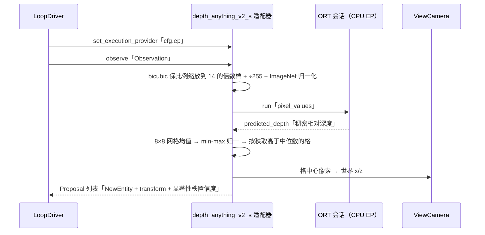

# L2 · 切片 C4「Depth-Anything-V2-Small 适配器」详细设计

> **设计版本**：v1 · **批准方式**：owner 批准**路线 A**（§8 二选一，AskUserQuestion 记录于 2026-10-19："批准路线 A，开始 TDD 实现"） · **批准日期**：2026-10-19
> 状态：**已交付（2026-10-19 收口）**——路线 A 实现完毕，slice14 与全量套件绿，证据见 [C4 regression 报告](../../../../benchmarks/regression/2026-10-19-stage-c-c4-depth-anything.md)；与本文的偏差登记在文末。路线 B（观测增强 / 契约变更 + ADR）本次**明确不采用**，留待 Phase 3 真实视频源出现后重估。
> 上承：[L1 §3/§4](../概要设计.md)（两个真模型适配器各单文件、内部双 provider）+ [C3 L2](03-rtdetrv2s-adapter.md)（同一条接缝的形态与它留下的 11 条偏差）+ [C3 报告](../../../../benchmarks/regression/2026-10-19-stage-c-c3-rtdetrv2s.md)。票据：[04-depth-anything-v2-small-adapter.md](../../../../.scratch/stage-c-ai-in-loop/issues/04-depth-anything-v2-small-adapter.md)。

## 1. 程序描述

**第二个模型家族进同一条接缝**，用来证伪一个可能的质疑："RT-DETR 走得通只是因为它的输出恰好是稀疏框"。Depth-Anything-V2-Small 输出**稠密逐像素相对深度图**（`predicted_depth`），形状与语义都与检测框无关；它仍必须只经 `observe(const Observation&) → vector<Proposal>` 入环，核心零改动。

本切片的**成功判据是接缝，不是深度的用处**——这一点必须先说清楚，因为下游事实很硬（§8）：**当前真值世界是 y≡0 的 x/z 平面，没有任何深度/高度真值**（`truth_world.cpp:22-25` 实体位置 `Vec3{unit, 0.0f, unit}`，`Entity` 无尺寸成员）。所以 C4 交付的是"契约家族无关"的证据 + 一条**真实图像上的深度链路正确性检查**，并如实声明深度在本世界不可评分；深度真正兑现价值在 Phase 3（真实视频入环，那时观察源才有几何）。

## 2. 数据结构

- **零新增核心类型**：复用 `ExecProvider`（core/types.hpp）、`PerceptionAdapter`、`Proposal` 五元组。C3 已开的两个扩展（`set_execution_provider` 默认 no-op、`first_fault`）够用，**不再扩接口**。
- 新文件 `src/perception/depth_anything.cpp`（单文件适配器，注册名 `depth_anything_v2_s`），CMake ON 分支加一行 `target_sources`，形态与 `rtdetr.cpp` 完全对称（含 `OW_WITH_ONNXRUNTIME` 守卫、`OW_DA_MODEL` 环境变量覆盖路径、宽字符路径转换、`OW_DA_DEBUG` 诊断）。
- 适配器内部状态：ORT 会话 + 运行期探测到的输入名/输出名/输出形状。**不假设形状**：`predicted_depth` 的布局（NCHW 与否）与 H/W 是否等于输入分辨率，首次运行时探测并断言其属于 `{1,1,H,W}` / `{1,H,W}` 家族，否则抛错并打印实际形状（C3 的"输出名约定漂移 → 运行期探测"教训沿用）。

## 3. 关键机制

### 3.1 预处理：必须与参考处理器同语义（C3 的直接教训，不重复犯）

一手依据 = `onnx-community/depth-anything-v2-small` 的 `preprocessor_config.json`（2026-10-19 拉取核对），`image_processor_type = DPTImageProcessor`：

| 键 | 值 | 含义 |
|---|---|---|
| `do_resize` + `size` | 518×518 | 缩放目标 |
| `keep_aspect_ratio` | **true** | **保比例**（与 RT-DETR 的强制正方形不同） |
| `ensure_multiple_of` | **14** | 边长取到 14 的倍数（DPT patch 约束） |
| `resample` | **3 = bicubic** | 不是 bilinear、更不是 nearest |
| `do_rescale` | 1/255 | 同 C3 |
| `do_normalize` | **true**，mean/std = ImageNet | **与 RT-DETR 相反**：这里必须归一化 |

**这张表本身就是 C3 教训的价值证明**：同一个仓库里两个真实模型，参考处理器在"是否归一化"上取值相反。若把 C3 的"÷255 不归一化"当成品味复用，C4 会直接错；若按论文默认"深度模型总得归一化吧"猜 C3，也会错。**结论进 problem-log：适配器的预处理常数必须逐模型对照一手配置，不允许跨模型迁移。**

实现取舍：`keep_aspect_ratio + ensure_multiple_of` 会产出非正方形输入（如 4:3 → 518×392）。本仓库的观察是**俯视单位正方形窗口**（世界 [0,1]² ↔ 像素），保比例缩放对正方形观察退化为 518×518，对非正方形观察（真实照片 640×480）才分叉。v1 取**长边缩到 518 档、短边按比例，两边各自取到 14 的倍数**（实测：640×480 → `518×392`，`392 = 28×14`），并在探测行里打印实际张量尺寸；不引入 padding（`do_pad: false`）。

### 3.2 相对深度：可辨识的只有序，不是距离

DA-V2 输出**相对**深度（仿射不定：同图整体缩放/平移后无法区分）。因此任何"这个物体在 2.3 米"式主张都**不可辨识**，本切片不提；可辨识的是**同一帧内的远近序**。归约设计必须建立在序上，不建立在绝对值上。

**稠密 → 稀疏归约（v1）**：把深度图划成 `8×8` 网格 → 每格取均值 → 帧内 min-max 归一 → 按**秩**排序 → 对**高于中位数**的格各出一条 Proposal：
- `target = NewEntity{}`；
- `fields.transform = Vec3{x, 0.0f, z}`，格中心像素经 `ViewCamera` 逆变换回世界 x/z（与 C3 同一恒等式：`world_x(px) = (px+0.5)/width`，俯视单位正方形下成立）；
- `confidence` = 该格均值在帧内 min-max 归一后的**显著度**，映射到 [0.5, 1.0]（保序，因此与"秩"携带同一信息；但它不是秩本身——收口评审指出措辞，已按实现改正）。
- **确定性**：全序 + 固定网格 + 单线程 ORT → 逐位可复现（同 C3 参考路径）。

**为什么是这个而不是"最近表面连通域"**：连通域生长要引入 ε 阈值与遍历序，两者都是新的任意性；网格秩归约没有可调魔数、复杂度 O(HW)、且"输出条数有界（≤32）"这条性质可以直接断言。代价是几何分辨率粗（1/8 格），**如实标注为 v1 取舍**。

**置信度语义的诚实声明**：契约⑦ 要求 confidence 是"自报的主张正确概率"。这里用的是**显著性秩**，它不是正确概率，且本世界无深度真值可校准（§8）。这一点写进代码注释与 C4 报告，**不假装它是校准过的置信度**。

### 3.3 provider 与容差

与 C3 完全同路径：CPU EP = 参考路径（实测抖动应为 0 → 窗口退化为逐位精确）；CUDA EP 接线，本机仍阻塞（cuDNN 9 缺口未变），**窗口标定继续移交 C5**。不重复声明数值。

## 4. 流程逻辑

## 5. 边界情形

| 情形 | 行为 |
|---|---|
| 深度图退化（min == max，纯平帧） | 归一不可定义 → **空 Proposal 列表**并 debug 打印退化原因（这里"空"是**适配器自己的确定性规则**的结果，不是对模型能力的假设——与 C3 problem-log 008 的区别要写清楚）。**实测：该分支从未触发，纯灰帧照样产出 32 条结构化提案**（见偏差记录 #3） |
| 输出形状不属于 `{1,1,H,W}` / `{1,H,W}` | 抛错，消息含实际形状与张量名（不猜布局） |
| 模型文件缺失 | 与 C3 同：首次 `observe()` 抛错 → 隔离层记 `first_fault`（含路径 + `node tools/fetch_models.mjs`）；**不在构造期抛**，理由见 C3 L2 偏差 #10（setup 期异常在 CLI 里是静默 fastfail） |
| 观察尺寸非正方形 | 保比例缩放到 14 倍数档；debug 打印实际张量尺寸 |
| `--ep cuda` | 同 C3：EP 追加失败 → 抛错 → `first_fault` 带原因；不静默降级 |
| 注册表基数 | `ow_slice03` 的 `kExpected` 在 ON 下 3 → **4**（C3 已埋哨兵，problem-log 010） |

## 6. 测试计划（slice14，仅 ON 构建注册）

1. **会话与推理冒烟 + 耗时记录**：加载、跑一张构造观察，打印输入张量尺寸与实际探测到的输出形状（**这条是"我不知道形状"的诚实出口**），并记录两次 `observe()` 耗时（首调含会话建立）。
2. **确定性配对**：同一 Observation 两次 `observe` → 逐字段相等；**并且**断言输出条数有界（`≤ 32`）。
3. **真实图像深度序检查**（本片的"链路正确"证据，C3 照片检查的同族）：`OW_DA_TEST_IMAGE` 指向 `models/photo_640x480.rgb`（同一张猫照）——**前景（猫/遥控器所在的上半区域）应比背景（沙发靠背）更近**。断言的是**序**，不断言绝对值；若极性相反，如实报告并把极性作为实测事实写进 L2 偏差记录（**不悄悄翻转代码凑测试**）。未设环境变量时打印 skipped。
4. **端到端**：`LoopDriver` 注册 `depth_anything_v2_s` 跑通、`adapter_faults == 0`、`first_fault` 为空、时间字段有值、账本条数如实打印。
5. **家族无关回归**：blob / rtdetr 均不受影响——`ow_slice13` 全绿 + 全量套件绿（ON 4 项适配器、OFF 14 项）。
6. **单文件不变式**：`git diff` 走查（新增核心行 = 0，见 §7）。

## 7. 与票据验收对照

| 票据 AC | 落点 |
|---|---|
| DA-V2-Small 单文件接入；核心零改动 | §2/§3 + 走查——**本片目标核心零改动**（C3 已把三个通用扩展开完） |
| 深度输出的契约映射在三态可见性 / Proposal 语义内解决 | §3.2 走 Proposal 语义（`NewEntity` + transform + 置信度），**零语义扩展**；"观测增强"路线在 §8 说明为什么需要 ADR |
| 容差窗口声明 + 延迟预算同 C3 | §3.3：CPU EP 0 窗口；CUDA EP 移交 C5 |
| git diff = 单文件 + build/文书 | §2（1 个源文件 + CMake 一行 + 文书），**这次应严格成立**（C3 的 PARTIAL 不该成为常态） |
| slice14 测试 | §6 |

## 8. 需 owner 裁定：深度进契约的两条路

票据原文给了"观测增强 **或** Proposal 语义"二选一，且规定"若超出 v0.1 冻结语义 → 升 ADR 走 v0.2，不硬改"。事实核对结果：

- **路线 A（本 L2 采用）：稠密深度 → 稀疏 Proposal**（§3.2）。契约零改动、核心零新增行、单文件不变式严格成立。**代价**：本世界无深度真值 → 这些 Proposal 的**正确性与置信度无因果关系**。按 `metrics.cpp` 的口径，落在实体 0.1 半径外的格心判 `NewEntity`（永远不算 correct），恰好压上的算 Matched（算 correct）——**它的 ECE 量到的是"固定格心偶然命中率"，不是校准判别力**。实测（C4 报告 §8）：`ece:depth_anything_v2_s = 0.6470`，且它把 `identity_stability` 压到 **0.000000**（announced 132 / applied 68）。因此 **C5 的判据 (c) 面板必须排除 `depth_anything_v2_s` 或单列说明**，否则是在拿一个偶然生产者凑分离量。这条已写进 §9 与 C5 票据。
- **路线 B：深度回写观察 / 参与三态可见性判定**（"观测增强"字面义）。**契约级变更**：适配器现在收的是 `const Observation&`（`adapter.hpp:19`），观察由生成器单点产出、适配器只读；且 `observation.visibility` 目前在 `src/` 与 `apps/` **无任何消费者**（只有测试读它）。要走 B 必须动"观察是谁的产物"这条数据方向 → **按票据规定升 ADR，不在 C4 硬改**。

**推荐 A**，理由：C4 的命题是"契约家族无关"，A 足以证明它，且不消耗契约变更预算；B 的真实收益要等 Phase 3（真实视频源）才存在——那时深度才有几何可对齐。**若 owner 选 B，本 L2 作废，改走 SOP-5（ADR）后重开。**

## 9. 风险登记

| # | 风险 | 处置 |
|---|---|---|
| R-C4a | 输出布局/形状与假设不符 | §2 运行期探测 + 断言 + 抛错含实际形状；测试 1 打印真值 |
| R-C4b | 相对深度极性（大=近 还是 大=远）未证实 | 不写进任何断言的前提；测试 3 用真实照片测**序**，结果无论哪向都如实入文（C3 的 `do_normalize` 教训） |
| R-C4c | 深度 Proposal 的正确性与置信度无因果关系，污染 C5 的 ECE 面板 | §8 路线 A 代价；**已实测并写进 C5 票据**（`ece:depth=0.6470`、`identity_stability=0`） |
| R-C4d | 置信度语义是显著性秩、非正确概率 | §3.2 明示声明；契约⑦ 下它零裁决权力、唯一消费者是校准指标——所以"它不是概率"必须写在报告里而不是藏在代码里 |
| R-C4e | 8×8 网格 + 中位数阈值是 v1 任意选择 | §3.2 标注为取舍；不做参数化（无第二个使用者，避免 Speculative Generality） |

## 偏差与扩展记录

> 收口时补记（2026-10-19）。全部实测证据：[C4 regression 报告](../../../../benchmarks/regression/2026-10-19-stage-c-c4-depth-anything.md)。

1. **双三次核取 Keys a=−0.5（Catmull-Rom），与参考处理器的 bicubic 同族不同参**：§3.1 要求"与参考处理器同语义"，但 PIL 的 bicubic 与 OpenCV/Catmull-Rom 的三次核参数不同。本实现**不声称与 Python 预处理位一致**，只声称核族一致 + 本项目自身逐位可复现（参考模式的确定性承诺是关于自己的，不是关于第三方库的）。若将来要与 HF 流水线做数值对齐，需要换核并另测。
2. **"不假设形状"落地为两层读取**：会话期静态元数据（实测 `[-1,3,-1,-1]`，输出为秩 3 动态形状）**只够做布局分类**，真实 H/W 必须从运行期张量取。第一版按静态值取 → `unexpected output extent` + 测试进程静默 fastfail，已修并把实际 dims 写进异常消息。→ problem-log 011。§2 原文"探测并断言其属于 {1,1,H,W}/{1,H,W} 家族"仍然成立，只是"探测"被拆成了静态分类 + 动态验尺两步。**收口评审又收紧了一次**：第一版的运行期校验是 `mh*mw ≤ n_elems 且 ≥ n_elems/4` 的宽松区间，`[1,4,H,W]` 这类多通道图会恰好落在界内被静默按单通道读取；现改为**精确等式**（单通道 ⇒ `n_elems == mh*mw`）、秩 4 时强制 `shape[1] == 1`、并要求 `mh,mw ≥ 8`（这同时保证每个网格至少收到一个像素，消除 `0/0` → NaN 置信度的路径——那是个真实缺陷，NaN 会让 `v <= median` 判假从而产出 conf=NaN 的提案）。异常消息现在同时含张量名与实际 dims。
3. **§5 行 1「退化帧 → 空列表」实测从未触发**：RGB 全 0x80 的纯灰帧仍产出 **32 条**结构化提案（格均值 spread 2.465）。空输出分支按原样保留（它是 min-max 除零的必要保护），但**不再作为可验收预期**；测试断言改为"有界 ≤32 + 两次调用逐字段相等"。这是 problem-log 008 在同一切片内的第二次复发，已回写 008。
4. **§6 测试 3 的深度极性改为实测事实**：断言保持**极性无关**（两半都有格、且两组均值不等），方向结论"值越大 = 越近"作为测量结果写在报告 §5（下半 27 格 vs 上半 5 格，最大格落在大猫身体上）。测试里 `upper != lower` 是浮点不等，只用作"两组不同"的粗判，不承担数值精度主张。
5. **§6 测试 5 从推理升级为正面断言**：原文靠"slice13 仍绿"论证家族无关；实现改为**两家族同面板跑一次**并断言 `ece:rtdetr_v2_s` 与 `ece:depth_anything_v2_s` 两个键同时存在——接缝与 per-producer 分解同时被证（实测 0.3898 / 0.6470）。
6. **§8/§9 的措辞修正（实现期自纠）**：本报告与票据初稿写过"深度 Proposal 永远 `correct=false`"。**不准确**：`matched_error` 只要求裁决为 Matched 且 err ≤ 0.1，固定格心**可以偶然命中**实体。准确表述是——其 correct 与否**与置信度无因果关系**，因此该生产者的 ECE **无意义**；两条说法指向同一结论（不得进判据 (c) 面板），但只有后者站得住。票据与 C5 预警已同步更正。
7. **核心零改动本片严格成立**：与 C3 的 PARTIAL（3 处通用核心改动）不同，本片 `git diff` 在 driver / observation / belief / metrics 上**零新增行**——C3 已把三个通用扩展开完，"单文件 + 核心零改动"这条 AC 回到它本来的强度。
8. **倍数取整用"最近"（`lround`），未与 HF 实现逐位核对**：本例 640×480 → `518×392`（`392 = 28×14`）与参考处理器一致；其他长宽比下"最近倍数"与 HF 的取整方向可能差一个 14 档。属**已登记的未证事项**，不是已证等价。
9. **ORT 会话胶水在两适配器间重复 = 单文件不变式的自觉代价**：`to_ort_path` / `resolve_model_path` / `ensure_session` 骨架（线程数、图优化级别、CUDA EP try-catch、会话状态字段）与 `rtdetr.cpp` 形状相同。抽公共头能消除重复，但会削弱"每个参与者 = 一个文件"的 git 证据形态，且必须回改已提交的 `rtdetr.cpp`。**本片选择不抽**，并如实登记两处已经出现的漂移（debug 标志一处是函数内 `static`、一处是成员）。第三个模型适配器出现时再评估抽取时机——那时重复成本才第一次超过不变式收益。
10. **测试 helper 的重复由本片自包含约定许可**：`load_photo`（slice13 照片加载器的第二份拷贝）与 `same_props`（与文件内既有 `proposal_eq` 形状相同）属 `ow_tests.cpp` 每片自成命名空间的既有约定。**但 `same_props` 已补成真正的逐字段比较**（收口评审指出它漏了 `tick_observed` / `target` / `y`，而报告写着"逐字段相等"）。
11. **§5 行 2 / 行 3 由实测运行覆盖，不进套件**：① 模型文件缺失——路径来自环境变量，测试进程内改环境变量会污染同进程其它用例，故以 CLI 实测取证：`first_fault` = `depth_anything_v2_s: model load failed at 'C:\nope\missing-depth.onnx' (... File doesn't exist); run: node tools/fetch_models.mjs`（2026-10-19 实测）；② 输出家族不符——需要造一个假图当夹具，本片判定不值得为此引入测试资产。两条都是"证据存在但不在 ctest 里"，如实标注。
