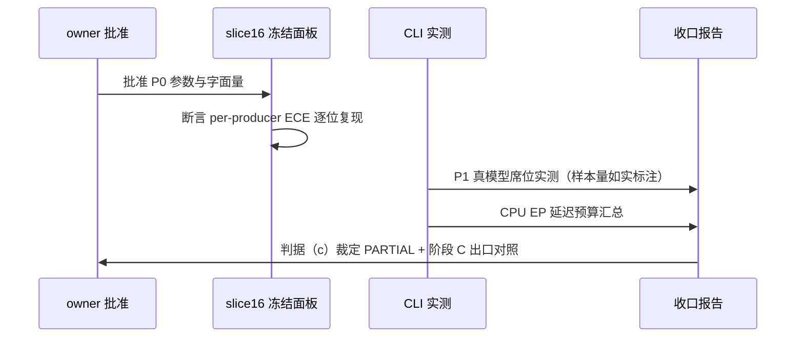

# L2 · 切片 C5「判据 (c) 重测 + 阶段 C 收口」详细设计

> **设计版本**：v1 · **批准方式**：owner 批准 L2 + §8 两项裁定全采推荐（G6 加 try/catch 并非零退出；G7 性能模式 faults>0 → 非零退出） · **批准日期**：2026-10-19
> 状态：**implementing**。**owner 已定的两条口径**：① 判据 (c) **如实裁定 PARTIAL + 完整论证**，不调阈值、不硬判达标；② CUDA EP 容差窗口**保持 PARTIAL**，不拿别人机器的数字填表。
> 上承：[L1 §1 出口判据](../概要设计.md) + §5 切片表 + [C3 报告](../../../../benchmarks/regression/2026-10-19-stage-c-c3-rtdetrv2s.md) + [C4 报告](../../../../benchmarks/regression/2026-10-19-stage-c-c4-depth-anything.md) + problem-log 005/006/007（判据 (c) 的三轮前史）。票据：[05-criterion-c-remeasure-and-stage-report](../../../../.scratch/stage-c-ai-in-loop/issues/05-criterion-c-remeasure-and-stage-report.md)。**阶段收口走 SOP-7。**
> **owner 已定的两条口径（2026-10-19）**：① 判据 (c) **如实裁定 PARTIAL + 完整论证**，不调阈值、不硬判达标；② CUDA EP 容差窗口**保持 PARTIAL**，不拿别人机器的数字填表。

## 1. 程序描述

三件事，顺序不可换：**先把面板口径定义清楚 → 再测 → 再裁定**。

判据 (c) 的原始主张（Gate 1，旧基线 ECE 分离 0.9617）是"**指标能判别'正常模型'与'注入错误置信度的模型'**"。阶段 A/B 两轮重测把它推到 PARTIAL（problem-log 006/007：分离量 0.189 / 0.184 < 0.30，原因是场景而非机制），并明确"关闭条件要等真实模型"。C3/C4 把真实模型请进了环，本切片负责回答：**那个等待兑现的席位，现在坐得下吗？**

**本切片的实测答案是"坐不下"，而理由本身就是交付物**：合成场景里没有任何生产者的 ECE 在度量校准——诚实检测器 0.1989、注入者 **0.0100**（它在合成场景里准确率≈0.98，0.99 的自报恰好"对"），两个真模型的 0.3898 / 0.6470 则是**固定格心偶然命中率的产物**。数值上"分离"处处成立，方向却与判据意图相反。**判据 (c) 因此在环部分维持 PARTIAL，关闭条件明确移交 Phase 3（真实视频 + 真标注）。**

## 2. 数据结构

- **核心零改动**（延续 C4 的严格形态）。
- 新增测试 `slice16`（**OFF 构建即可跑**——只用内建 blob 检测器，不碰 ORT），把本轮冻结的面板参数与 per-producer ECE 值写成**字面量断言**。
- 新增报告 `benchmarks/regression/2026-10-19-stage-c-closeout.md`：判据 (c) 裁定 + 阶段 C 出口对照 + 延迟预算汇总。
- 无新类型、无新接口、无新依赖。

## 3. 关键机制

### 3.1 面板口径（先定义，后测量）

| 面板 | 参与者 | 参数 | 用途 |
|---|---|---|---|
| **P0 冻结合成面板** | `blob_detect` + `blob_detect_overconfident` + `linear_extrapolation` + `zero_delta` | **600 ticks / seed 42 / 64×64 / footprint 0.02 / bounds none / reference / CPU** | 判据 (c) 的"机制仍在判别"证据；参数写死进 slice16 |
| P1 真模型席位候选 | `rtdetr_v2_s`（+ 注入者对照） | 同上，但 ticks 受限（见 §3.3） | 测"真实模型能否坐进'接近校准'席位" |
| P2 深度生产者 | `depth_anything_v2_s` | — | **明确排除**（C4 报告 §8：其 correct 与置信度无因果关系） |

**冻结纪律**（problem-log 006 的直接教训）：分离量只在**同一场景参数**下可比。P0 的参数因此进测试字面量，而不是每次随手挑。

### 3.2 判据 (c) 的裁定规则（写死，避免测完再找说法）

- **机制半条**：per-producer ECE 分解存在且对置信度扰动敏感 → 已由 B2/B4 单测证明，本轮用 P0 复测确认未退化。
- **在环半条**：需要"一个接近校准的真实模型"与"一个注入错误置信度的模型"在同一面板里被分开。**裁定为 PARTIAL 的充分条件**（本轮已满足）：真实模型席位缺席或被证明不可解释。
- **禁止**：调 0.30 阈值迁就数字（006/007 两轮已确立）；把"数值分离"当成"判据达标"。

### 3.3 延迟预算测量协议

阶段 C 出口判据里有"性能模式延迟预算实测（4060 8GB）"。本轮的可测部分与不可测部分必须分开报：

| 项 | 本轮能否实测 | 口径 |
|---|---|---|
| CPU EP 参考路径延迟 | ✅ | Release `build-ort-rel/`；`observe()` 全程；p50/p95；单线程是**确定性约束**不是最快配置 |
| 端到端面板成本 | ✅ | 真实模型面板 **600 ticks ≈ 6 分钟/面板**（0.6 s/tick 量级）——这本身是结论：**判据重测不能拿真模型跑 600 ticks 的粗网格**，故 P1 用 5–20 ticks 并如实标注样本量 |
| CUDA EP 延迟 + 容差窗口 | ❌ | 本机缺 cuDNN 9 / CUDA 12.8+，EP 载入失败（C3 §6、C4 §9 两次实测）。**保持 PARTIAL，移交环境就绪后** |
| 环境元数据 | ✅ | 每份报告带 OS/CPU/GPU/编译器/构建类型/commit；数字标模式 |

### 3.4 阶段 C 出口对照（PLAN §六 Phase 2 行 + L1 §1）

| 出口判据 | 本轮自查 |
|---|---|
| 真模型 = 单文件适配器、核心零改动 | ✅ C3（PARTIAL：3 处通用核心改动）+ C4（严格：零新增行）——两条都如实记，不取平均 |
| 参考模式位级复现保持 | ✅ OFF 14/14 + ON 16/16；600/42 基线哈希 `574361e62eec92b9` / `459ff85132cc103e` 在两种构建下逐位不变（2026-10-19 复测） |
| 性能模式延迟预算实测（4060 8GB） | ⚠️ **PARTIAL**：CPU EP 侧已实测并冻结；CUDA EP 侧环境阻塞，窗口与预算移交（owner 已确认此裁定） |
| 附带关闭判据 (c) 在环部分 | ⚠️ **PARTIAL + 论证**（§1/§3.2），关闭路径 = Phase 3 |
| 对外工件：延迟分解 benchmark 笔记 | ✅ 三份 regression 报告（C3 / C4 / 本收口） |

## 4. 流程逻辑

## 5. 边界情形

| 情形 | 行为 |
|---|---|
| 冻结字面量在新工具链上漂移 | slice16 会红——**这是有意的**：ECE 字面量与基线哈希同属"工具链钉死"的断言，漂移必须显式承认并更新，不允许悄悄放宽 |
| P1 样本量小导致 ECE 分箱稀疏 | 报告里给出条数与分箱占用，**不外推**、不与 P0 的 600-tick 数字并列比较 |
| CUDA EP 环境在收口后才就绪 | 窗口标定作为**阶段 C 之后**的独立动作（挂 research-queue / Phase 3 前置），不回头改本收口报告的结论 |
| 深度生产者被误入面板 | slice16 不引用它；报告 §面板口径写明排除理由（C4 H4） |

## 6. 测试计划（slice16，OFF 与 ON 两种构建都注册）

1. **冻结面板复现**：600 ticks / seed 42 / 默认参与者 → 断言 `ece:blob_detect == 0.19890412565780013`、`ece:blob_detect_overconfident == 0.009999990463256836`、`ece == 0.4940744921482492`、`ledger_entries == 9746`、`world_hash == 574361e62eec92b9`（**2026-10-19 实测值**）。行为断言与确定性断言成对（problem-log 002）：字面量既钉行为也钉复现。
2. **分解有效性**：断言两个 per-producer 键**都存在且不相等**——聚合值掩盖结构的老坑（005）由此持续被守。
3. **不编码裁定**：slice16 **不**断言"分离量 < 0.30"之类的判据结论（那是报告的职责；测试里编码失败结论会让 PARTIAL 变成"绿"）。
4. **CLI 错误语义**（若 §8 任一裁定被批准）：非零退出码 + stderr 有原因 + 工件仍写。
5. 全量回归：OFF 14/14（+slice16 → 15）、ON 16/16（→ 17）。

## 7. 与票据验收对照

| 票据 AC | 落点 |
|---|---|
| per-producer ECE 分离量实测（真模型 vs 夸大；对照 0.30） | §3.1/§3.2 + §6 测试 1；分离量 0.189（P0）与真模型席位不可解释的论证 |
| regression 报告落 `benchmarks/regression/` | §2 收口报告（环境元数据 + mode + 延迟 + 模型清单与许可） |
| 判据 (c) 裁定：达标 → 更新 PLAN；未达标 → 如实 PARTIAL + 关闭路径 | **PARTIAL**，关闭路径 = Phase 3（真实视频 + 真标注），PLAN 阶段 C 行同步 |
| 阶段 C 出口对照逐条自查；CURRENT → 阶段收口 | §3.4 + §9 SOP-7 |
| （C3/C4 预置）CUDA 窗口、面板口径、CLI 语义 | §3.3 保持 PARTIAL / §3.1 排除深度 / §8 裁定 |

## 8. 需 owner 裁定：CLI 错误语义两项（C3 收口时明确"排到 C5"）

**G6 · setup 期异常无出口**（实测：`--adapters does_not_exist` → exit `0xC0000409`、stdout/stderr **零输出**、**无工件**）。
- **推荐**：`apps/omniworld_loop.cpp` 的 `main()` 给 `parse_config` 之后的整段包一层 `try/catch (const std::exception&)` → 打印 `error: <what>` 到 stderr、返回非零。约 6 行，不改任何工件语义、不影响确定性（测试走库不走 CLI）。
- 备选：不动，把缺口记进 Phase 3 前置。

**G7 · `--ep cuda` 的 fail-fast 与隔离层互斥**（实测：经 loop 时表现为 ticks 正常跑完 + `faults=1` + `first_fault` 带原因 + **exit 0**）。
- **推荐**：**性能模式下 `adapter_faults > 0` → 退出码非零**（工件仍照常写出）。理由：一次有参与者静默失败的运行不构成一次合格测量，而退出码是目前唯一的"这次能不能用"信号。参考模式不动（保持现状语义）。
- 备选：加 `--strict` 开关（更保守，但多一个参数面）；或保持现状并把差异只留在 `first_fault` 里。

**两项都属于 B1 CLI 语义，因此不预授权执行**；批准哪条就实现哪条，未批准的在收口报告"遗留"节如实登记。

## 9. 收口动作清单（SOP-7）

1. 收口报告落库（判据裁定 + 出口对照 + 延迟汇总 + 模型清单与许可 + 遗留项）。
2. `problem-log.md` 阶段 C 条目汇总核对（008–011 是否都需要进面试素材）。
3. `docs/interview-narrative.md` 新增**阶段 C** STAR 段（该文件按阶段追加，阶段 A 已有 4 条为样板）。
4. `PLAN.md` 阶段 C 行 → 完成状态（含两条 PARTIAL 的如实标注）；`CURRENT.md` → 指向阶段 D / Phase 3 的选定。
5. 票据 05 置 `done`；阶段 C 五片全部关闭。
6. `docs/agents/workflow-manual.md` 若有流程级教训（本轮候选：可选依赖构建的全量套件纪律已进 AGENTS #4）核对是否需要回填。
7. **retro**（技能映射表要求）：阶段 C 的"做对了什么/什么该改流程"，产出进收口报告末节或 problem-log。

## 偏差与扩展记录

> 收口时补记（2026-10-19）。证据：[阶段 C 收口报告](../../../../benchmarks/regression/2026-10-19-stage-c-closeout.md)。

1. **§6 测试 4（CLI 错误语义）不进 ctest，改由实测取证**：`apps/` 不是 ctest 覆盖对象（零依赖检查框架不 spawn 进程），而把退出码逻辑下沉进库以变得可测，需要在 `driver` 里新增一个"CLI 决策函数"——与 §2"核心零改动"冲突。因此 G6/G7 以**四条实测**登记（修前/修后对照见收口报告 §5），并如实标注"无自动化回归保护"。若将来给 `apps/` 建测试目标，再补断言。
2. **ECE 字面量用 ±1e-12 而非逐位相等**：同工具链下这些 double 是逐位可复现的（slice16 实测如此），但字面量要穿过编译期常量比较；留一个远小于任何真实漂移（P1 里真模型跨面板漂 0.25）的容差，使"编译器 FP 变更"表现为一条带 delta 的具名失败，而不是一个无法解释的相等性 miss。这不是放宽——005/006 类漂移量级在 1e-2。
3. **P1 面板样本量 20 ticks 而非 600**：600 ticks × 真模型 ≈ 6 分钟/面板（§3.3 的实测结论），判据重测不需要也不该付这个粗网格成本；样本量与由此产生的 ECE 不确定性在收口报告 §1 明示，**不与 P0 的 600-tick 数字并列比较**。
4. **构建目录迁移**：`build-ort-rel/` 被 Windows Search 索引器反复咬住（`mt.exe` 清单嵌入 `0x1f` 共享冲突），换全新目录同样发生、重试即过。本轮指标数字因此来自 `build-ort-c5/`（同为 Release + ON）。已把 `build-ort*/` 合并成一条 ignore 规则；索引器排除属机器配置，不进仓库（收口报告 §8 L5）。
5. **判据 (c) 的裁定不是"再测一次"**：本文 §3.2 预设的是"达标 / 未达标 / PARTIAL"三选一，实测给出的是第四种——**判据的前提（存在一个与真值定义域相交的真实模型）在本世界不成立**。处理方式按 owner 裁定：如实 PARTIAL + 把关闭条件重新定位到 Phase 3，**而不是**调阈值或换面板直到过线。→ problem-log 012。
6. **slice16 的参与者是"显式写出的 CLI 默认面板"**：§6 测试 1 写"默认参与者"，而 `RunConfig` 依 L1 §6 不带任何默认值（默认只存在于 `parse_config`），所以测试必须显式列出同一套参与者。两条路径的**等价性已实测**：CLI `--ticks 600 --seed 42`（不带 `--adapters`）与 slice16 给出完全相同的 ECE/哈希/条数字面量。
7. **收口评审（两轴）的修正**：① slice16 的成功输出里曾印着 `(< 0.30)` ——**被 §6 测试 3 明令禁止的裁定字符串以另一种形式回来了**，已删，只留事实数字；② G6 的 try 范围原窄于批准文本（"parse_config 之后的整段"），已把 parse 之后的全部工作收进 `run_and_report()` 由 `main()` 统一包 try/catch，并把退出码语义写进 usage 文本；③ 收口报告两处交叉引用指错页（0.3898 出自 C4 §7 而非 C3 §8；518 ms 出自 C3 §5 而非 §6）与一处计数漏了 012，已更正；④ §9.7 retro 与 §9.6 流程回填核对原为**未兑现的清单项**，现补 §8 retro 段与回填核对结论；⑤ slice16 补 `cfg.ep = CpuEp`（与同类基线测试一致，避免依赖默认值的静默漂移）并更正"epsilon 会打印 delta"的注释（CHECK 只印条件文本）。
8. **ADR 同步**：G7 给性能模式补了一条"可机器判定的合格性信号"，属 ADR-0009 承诺的延伸 → 记在 [ADR-0012](../../../adr/0012-onnxruntime-optional-dependency.md) 的 Consequences（阶段 C 的 ADR），**不改写 ADR-0009 原文**；该 ADR 里"CLI 语义待 C5 裁定"的遗留条已按结果更新。
